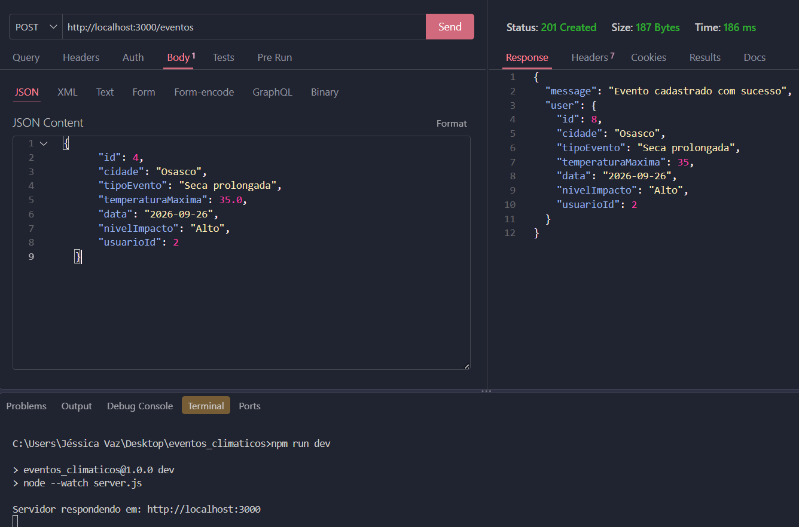
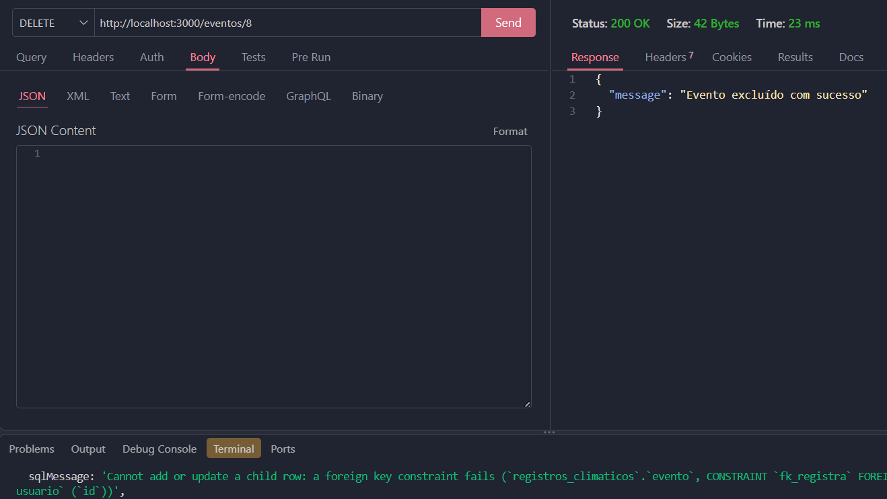
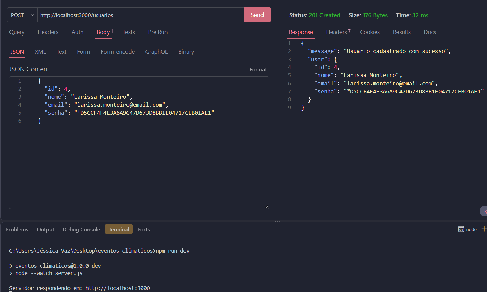
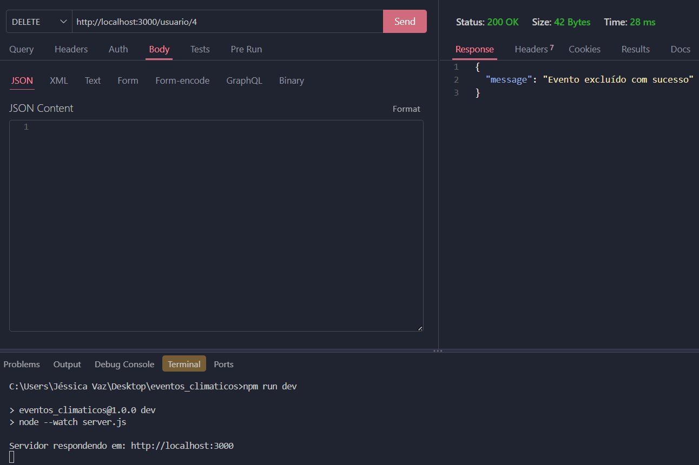

# Eventos Climáticos: Atividade - Aula 09

## Documentação

### MER DER Conceitual


### UML - DC (Diagrama de Classes)


## Tecnologias utilizadas:
 - Node.js
 - JavaScript
 - VsCode
 - VsCode Thunder Client

 ## Passos para testar:
1. Clone este repositório;
2. Abra com VsCode e em um terminal digite:
```
npm install
npm run dev
```
3. Teste as rotas com a extensão Thunder Client do VsCode;
4. Abra o arquivo client/index.html com a extensão Live Server do VsCode.

## Print dos testes:

 - Cadastrar Evento:



 - Listar Evento:


 - Excluir Evento:



 - Atualizar Evento:

 - Cadastrar Usuario:



 - Listar Usuario:

 

 - Excluir Usuario: 

 

 - Atualizar Usuario: 